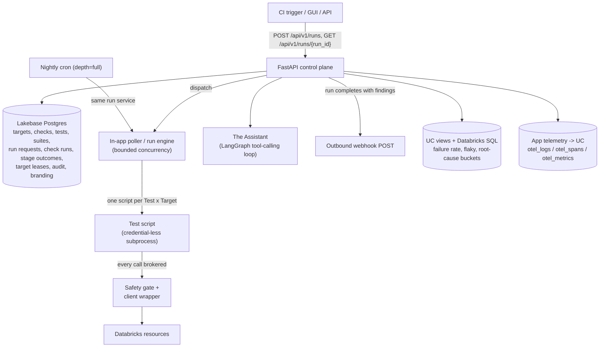

# Architecture

This is a component/data-flow tour of the codebase. It uses the vocabulary
defined in [`../CONTEXT.md`](../CONTEXT.md) without redefining it — if a term
below is unfamiliar, look it up there rather than inferring a meaning from
context. Design rationale for anything non-obvious lives in
[`docs/adr/`](adr/); this doc doesn't restate it.

## Overview

The platform is a Databricks App: a single **FastAPI** process acting as the
**control plane** and **durable result store**. It serves the REST API and the
built React SPA. Runs execute **in-app**, concurrently, with bounded
parallelism — there is no Databricks Job fan-out and no remote-agent
subsystem. The nightly run is started by the in-app poller on a cron, through
the same run service as the Run API.

## Components

### Control plane (FastAPI, `backend/app`)

- `core/enums.py` - the small, genuinely closed vocabulary: run status,
  Test status, expectation, risk tier, safety class, phase, depth, request
  source, audit action. The **canonical stage spine** and the
  **failure taxonomy** are deliberately *not* enums — they're data
  (`core/stages.py`, `core/taxonomy.py`), so a new stage or failure bucket is a
  registry entry, not a code migration.
- `core/operations.py` - the open-SDK call model + the R3-never blocklist
  (ADR-0017): any SDK/REST call a script makes, judged by its verb and the
  blocklist rather than a curated manifest.
- `core/config.py` - dual-mode auth. In a Databricks App it uses the injected
  service-principal OAuth identity (`WorkspaceClient()`); locally it falls
  back to the developer's CLI profile and SQLite (`RV_LOCAL_DEMO=1` forces the
  fully offline/simulated path). The Lakebase password is a short-lived OAuth
  token injected per connection.
- `models/models.py` - the SQLModel tables: `Check`, `Test`, `TestCheck`,
  `Suite`, `SuiteMember`, `Target`, `EntityVersion`, `RunRequest`, `CheckRun`,
  `StageOutcome`, `TargetLease`, `AuditEvent`, `Branding`, `WebhookConfig`,
  `AssistantConfig`.
- `script_runtime/` - the Test script runtime (see below): static analysis,
  the SDK catalog the editor autocompletes from, the sandboxed runner, and the
  stand-in workspace demo mode runs against.
- `services/` - `run_service` (submit/dispatch/execute/aggregate),
  `script_tests` (a Test's script, its checks and versions), `locking` (target
  leases), `safety` + `risk` (the safety gate), `findings` + `flaky` (the
  "What's Interesting" feed), `retention`, `audit`, `versioning`, `roles`
  (Run-as-role), `rca`, `assistant` / `assistant_graph` / `assistant_tools`
  (the Assistant shelf), `editor_agent` + `assistant_config` (the test
  editor's assistant and its settings), `webhook`, `branding`, `seed`.
- `workers/poller.py` - claims queued Run requests and dispatches them with
  bounded concurrency (`MAX_RUN_CONCURRENCY`).
- `api/v1/` - REST routers: `runs`, `checks` (read-only), `tests`, `scripts`
  (analysis, dry runs, the SDK index), `suites`, `targets`, `findings`,
  `assistant`, `admin`, `audit`, `branding`, `webhook`, `health`.

### Test scripts

Every Test is a Python script ([Writing tests](./writing-tests.md)). Each
`with check("…"):` block declares one Check, keyed by its literal name so its
id and run history survive edits; saving a script re-derives the Test's Checks
from it.

A run executes the script once per Target in a **credential-less
subprocess**. The script reaches Databricks only through the pre-bound `w`,
`w.api`, `sql()` and `http()`, and each of those calls is **brokered**: the
platform makes it on the script's behalf, through the safety gate (blocklist,
then the call's risk tier against the Target's safety class, then any
override), as the Target's identity. At `quick` depth a mutating call is
skipped. One script run produces one `CheckRun` per declared check.

There is **no operation allowlist**: under open-SDK authoring, the ground
truth for what a script may call is "the SDK/OpenAPI surface minus the
blocklist" (the global R3-never floor), not a curated manifest.

Each check's outcome maps onto the **canonical stage spine**
(`RESOLVE -> CONNECT -> TLS -> AUTHENTICATE -> AUTHORIZE -> OPERATE ->
VERIFY`): a network failure stops at `CONNECT`, a permission error at
`AUTHORIZE`, a failed `assert` at `VERIFY`. Connectable/functional is a derived
view computed from the stage reached, not a stored field.

### Data flow for a Run

1. `POST /api/v1/runs` creates a `RunRequest` (phase `queued`).
2. A Target's **lease** (`TargetLease`, a Lakebase row with a
   heartbeat-renewed TTL) serializes Runs on mutating Targets — `read-only`
   Targets never lock.
3. The in-app poller claims the request and dispatches it with bounded
   concurrency, running each selected Test's script against each Target at the
   Run's `Depth` (`quick` or `full`). The **safety gate** judges every call the
   script makes as it makes it. Each check produces a `CheckRun` + ordered
   `StageOutcome` rows.
4. The Run is aggregated into a `RunStatus` verdict: gating comes from the
   gating checks only; a check the script marks `advisory=True` is recorded as
   signal and never flips the verdict.
5. Callers poll `GET /api/v1/runs/{run_id}` until the phase is `terminal`.
   A completed Run with ≥ 1 finding fires the best-effort outbound webhook and
   feeds the "What's Interesting" view.

The **nightly run** (`app/services/nightly.py`) is not a separate execution
path. On `nightly_cron` the poller submits a `depth=full` run of everything
through the same run service as `POST /runs`, once per cron slot.

### Storage split

- **Lakebase (operational)**: everything mutable and transactional — the
  system of record for Targets, the Test/Check/Suite catalog, Run history,
  target leases, the audit log, and branding. Survives app redeploys.
- **Unity Catalog views + Databricks SQL (analytical)**: rollups for
  dashboards (`infra/sql` — failure rate by test/target, flaky tests, root
  cause buckets, daily run summary). The operational tables are exposed to UC
  via Lakehouse Federation or a scheduled sync. There is no in-app charting
  library; visualization is left to Databricks SQL / Lakeview against these
  views.
- **App telemetry -> UC**: `otel_logs/otel_spans/otel_metrics` for operator
  correlation.

### The Assistant

A single, app-wide AI agent (ADR-0012) reachable from every page via the
Assistant shelf. It runs as a LangGraph tool-calling loop (ADR-0019) over a
**closed** tool inventory (ADR-0020) — authoring and triage/RCA are the same
agent, differentiated by which tools a turn can reach, not separate agents.
The shelf answers questions and suggests causes; a request to write a test is
handed to the test editor, where the same Assistant gets editor tools (SDK
search, docs, read-only SDK calls and SQL, edit, validate, dry run) and streams
each step to the browser as it runs. Its model and per-turn limits are one
audited `AssistantConfig` record (**Settings → Assistant**). There is no
external/remote agent in this system; "the Assistant" always refers to this one
in-app agent.

## Assumptions

- Mirrors the `edh-ssc` house layout (frontend at root building to
  `backend/static`; `backend/run.py` entrypoint; `databricks.yml` bundle using
  `config.command`).
- SQLModel + Alembic; SQLite locally, Lakebase Postgres on Databricks.
- Frontend is React + TypeScript + Vite + TanStack Query; no charting library
  is wired in yet.
- Tests are scripts against the open SDK surface, so a new kind of check is a
  few lines of Python, never a new class in the backend.
