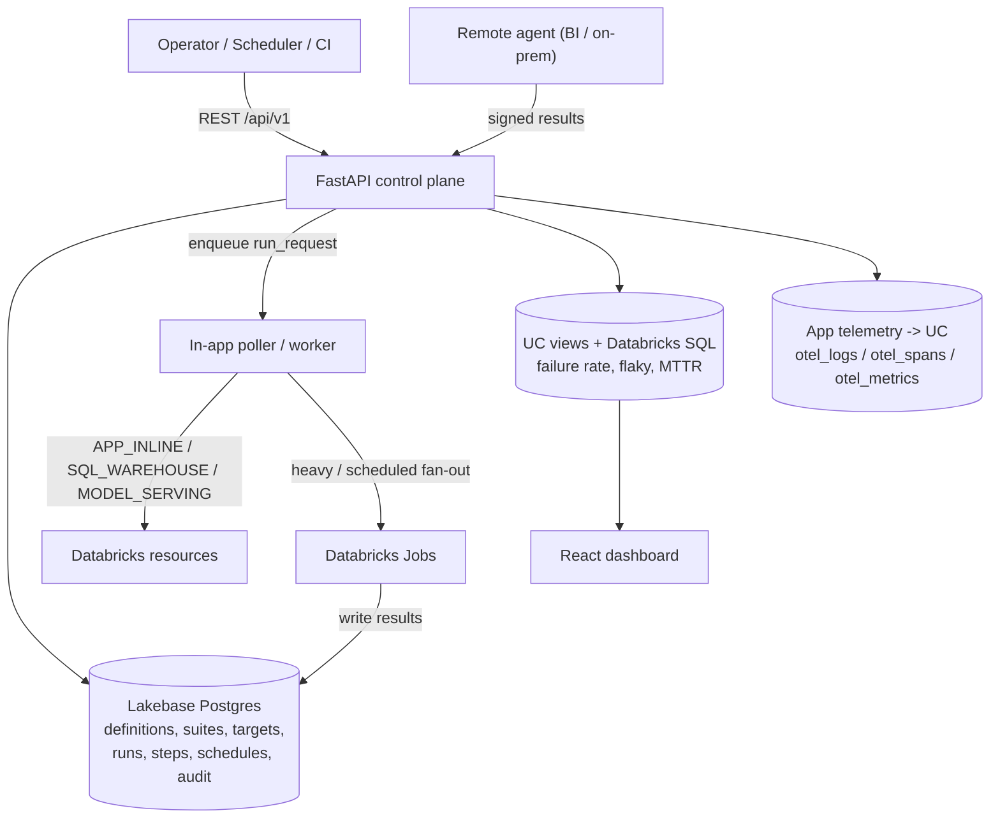

# Architecture

## Overview

The platform is a Databricks App (single FastAPI process) acting as the
**control plane** and **durable result store** for plugin-based probes. It
orchestrates and displays runs; it does not perform all heavy validation inline.

## Components

### Control plane (FastAPI, `backend/app`)

- `core/enums.py` - the canonical vocabulary: `ProbeOutcome`,
  `ConnectivityOutcome`, `ExecutionMode`, `ExecutorKind`, `TestCategory`,
  `AuthMode`, `RunStatus`, `StepKind`, and the 19-value `RootCauseBucket`.
- `core/config.py` - dual-mode auth. In a Databricks App it uses the injected
  service-principal OAuth identity (`WorkspaceClient()`); locally it uses the
  CLI profile and SQLite. The Lakebase password is a short-lived OAuth token
  injected per connection (`db/session.py` `do_connect` listener).
- `models/models.py` - SQLModel tables (operational system of record).
- `executors/` - the probe framework (see below).
- `services/` - `run_service` (submit/fan-out/execute/aggregate), `schedule_service`
  (Databricks Jobs cron), `audit`, `analytics`, `seed`.
- `workers/poller.py` - claims PENDING `run_request` rows and dispatches them.
- `api/v1/` - REST routers.

### Probe framework

Each probe answers the six-question contract in order, mapped to `StepKind`:

`PRECHECK -> AUTH -> DNS -> NETWORK -> FUNCTIONAL -> CLEANUP`

- **Connectable** = PRECHECK + AUTH + DNS + NETWORK are non-failing.
- **Functional** = FUNCTIONAL passes.
- Modes: `PREFLIGHT` (connectable only), `SMOKE` (minimal functional),
  `FULL` (end-to-end). Cleanup always runs in a `finally` block unless the
  cleanup policy is `NEVER` (or `ON_SUCCESS` and the functional step failed).

Executors register under an `executor_key` (`executors/registry.py`). A test
definition names its `executor_key`; unknown/unsupported keys resolve to a
capability-gated stub that SKIPs cleanly. **Adding a test = a definition row +
optionally a small executor class** - no edits to unrelated files.

### Data flow for a run

1. `POST /api/v1/runs` creates a PENDING `run_request` (idempotent on
   `idempotency_key`).
2. The poller (or a Databricks Job) claims it, expands the selection
   (suites/tests x targets/catalogs) into `test_runs`, and executes them with
   bounded concurrency.
3. Each probe yields ordered `test_run_steps`; the run is aggregated into a
   status, connectivity outcome, failure buckets, and a normalized root cause.
4. The UI polls run detail; analytics roll up across runs.

### Storage split

- **Lakebase (operational)**: everything mutable and transactional - the system
  of record. Survives app redeploys.
- **Unity Catalog views + Databricks SQL (analytical)**: rollups for charts
  (`infra/sql`). The operational tables are exposed to UC via Lakehouse
  Federation or a scheduled sync.
- **App telemetry -> UC**: `otel_logs/otel_spans/otel_metrics` for operator
  correlation (joined in `telemetry_joined_events`).

### Why a remote agent?

A run from inside the app proves the **Databricks-side** path. It cannot prove
that a Power BI desktop, a corporate-network client, or an on-prem Oracle host
can reach the lakehouse. Remote agents run at those vantage points and post
**signed** results to the control plane. See
[`../shared/remote_agent_protocol.md`](../shared/remote_agent_protocol.md).

## Assumptions

- Mirrors the `edh-ssc` house layout (frontend at root building to
  `backend/static`; `backend/run.py` entrypoint; `databricks.yml` bundle using
  `config.command`).
- SQLModel + Alembic; SQLite locally, Lakebase Postgres on Databricks.
- Frontend uses TanStack Query + Recharts per the build spec.
- First pass ships 4 live executors; the remainder are seeded metadata + stubs.
