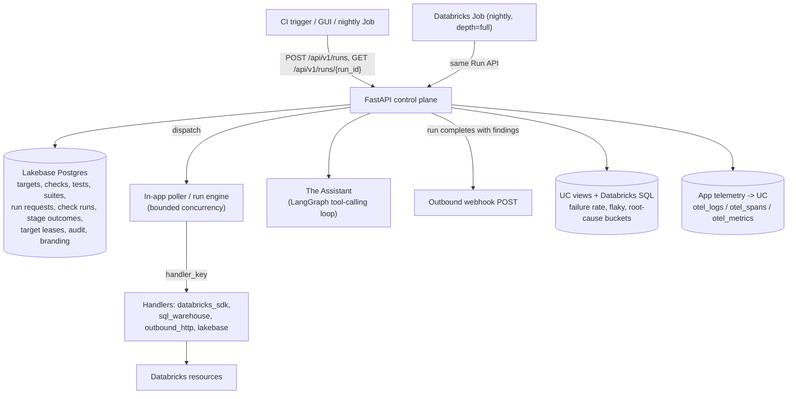

# Architecture

This is a component/data-flow tour of the codebase. It uses the vocabulary
defined in [`../CONTEXT.md`](../CONTEXT.md) without redefining it — if a term
below is unfamiliar, look it up there rather than inferring a meaning from
context. Design rationale for anything non-obvious lives in
[`docs/adr/`](adr/); this doc doesn't restate it.

## Overview

The platform is a Databricks App: a single **FastAPI** process acting as the
**control plane** and **durable result store**. It serves the REST API and the
built React SPA. Runs execute **in-app**, concurrently, with bounded
parallelism — there is no Databricks Job fan-out for ordinary Runs and no
remote-agent subsystem; the only Databricks Job in the system is the nightly
suite runner, and it is just another authenticated caller of the same Run API
everything else uses.

## Components

### Control plane (FastAPI, `backend/app`)

- `core/enums.py` - the small, genuinely closed vocabulary:
  `ProbeOutcome`, `RunStatus`, `Evaluator`, `TestStatus`, `Expectation`,
  `RiskTier`, `SafetyClass`, `Phase`, `Depth`, `RequestSource`,
  `CleanupPolicy`, `AuditAction`. The **canonical stage spine** and the
  **failure taxonomy** are deliberately *not* enums — they're data
  (`core/stages.py`, `core/taxonomy.py`), so a new stage or failure bucket is a
  registry entry, not a code migration.
- `core/operations.py` - the open-SDK operation model + the R3-never
  blocklist (ADR-0017): a Check's operation is `{service, method, verb,
  params}`, not a curated manifest entry.
- `core/config.py` - dual-mode auth. In a Databricks App it uses the injected
  service-principal OAuth identity (`WorkspaceClient()`); locally it falls
  back to the developer's CLI profile and SQLite (`RV_LOCAL_DEMO=1` forces the
  fully offline/simulated path). The Lakebase password is a short-lived OAuth
  token injected per connection.
- `models/models.py` - the SQLModel tables: `Check`, `Test`, `TestCheck`,
  `Suite`, `SuiteMember`, `Target`, `EntityVersion`, `WorkedExample`,
  `RunRequest`, `CheckRun`, `StageOutcome`, `TargetLease`, `AuditEvent`,
  `Branding`, `WebhookConfig`.
- `executors/` - the Handler framework (see below; the package predates the
  CONTEXT.md rename to "Handler" but the concept is the same).
- `services/` - `run_service` (submit/dispatch/execute/aggregate),
  `locking` (target leases), `safety` + `risk` (the safety gate), `authoring`
  + `assertion_compiler` (plain-English -> deterministic where possible),
  `agentic_evaluator`, `findings` + `flaky` (the "What's Interesting" feed),
  `retention`, `audit`, `versioning`, `roles` (Run-as-role), `rca`,
  `assistant` / `assistant_graph` / `assistant_tools` (the Assistant), `webhook`,
  `branding`, `yaml_export`, `seed`.
- `workers/poller.py` - claims queued Run requests and dispatches them with
  bounded concurrency (`MAX_RUN_CONCURRENCY`).
- `api/v1/` - REST routers: `runs`, `checks`, `tests`, `suites`, `targets`,
  `findings`, `assistant`, `admin`, `audit`, `branding`, `webhook`, `health`.

### Handler framework

Handlers register under a `handler_key` (`executors/registry.py`); a Check
names the `handler_key` of the Handler that performs its operation. Four ship
today, all in `executors/builtin/`:

| `handler_key`    | File                | Handles                                    |
|-------------------|----------------------|---------------------------------------------|
| `databricks_sdk`  | `generic.py`         | Any Databricks SDK/API call (open-SDK)      |
| `sql_warehouse`   | `sql_warehouse.py`   | Statements against a SQL warehouse          |
| `outbound_http`   | `outbound_http.py`   | Outbound HTTP egress checks                 |
| `lakebase`        | `lakebase.py`        | Queries against the app's own Lakebase store|

There is **no operation allowlist**: under open-SDK authoring, the ground
truth for what may be expressed is "the SDK/OpenAPI surface minus the
blocklist" (the global R3-never floor), not a curated manifest. A Check that
names an unregistered `handler_key` resolves to a clean stub that `SKIP`s with
a `SERVICE_UNSUPPORTED` failure bucket rather than crashing.

Each Handler maps its outcomes onto the **canonical stage spine**
(`RESOLVE -> CONNECT -> TLS -> AUTHENTICATE -> AUTHORIZE -> OPERATE ->
VERIFY`), skipping stages it doesn't have — it never invents a private stage.
Connectable/functional is a derived view computed from the stage reached, not
a stored field.

### Data flow for a Run

1. `POST /api/v1/runs` creates a `RunRequest` (phase `queued`).
2. The **safety gate** checks each Check's operation risk tier against its
   Target's safety class before dispatch; a Target's **lease**
   (`TargetLease`, a Lakebase row with a heartbeat-renewed TTL) serializes Runs
   on mutating Targets — `read-only` Targets never lock.
3. The in-app poller claims the request and dispatches it with bounded
   concurrency, executing each Check through its Handler up to the Run's
   `Depth` (`quick` or `full`). Each Check produces a `CheckRun` + ordered
   `StageOutcome` rows.
4. The Run is aggregated into a `RunStatus` verdict: gating comes from
   `deterministic` Check results only; `agentic` results are recorded as
   advisory signal and never flip the verdict.
5. Callers poll `GET /api/v1/runs/{run_id}` until the phase is `terminal`.
   A completed Run with ≥ 1 finding fires the best-effort outbound webhook and
   feeds the "What's Interesting" view.

The nightly **suite runner** (`databricks/jobs/run_suite.py`, a Databricks
Job on a cron schedule) is not a separate execution path — it calls the same
Run API at `depth=full` against the deployed app's URL.

### Storage split

- **Lakebase (operational)**: everything mutable and transactional — the
  system of record for Targets, the Test/Check/Suite catalog, Run history,
  target leases, the audit log, and branding. Survives app redeploys.
- **Unity Catalog views + Databricks SQL (analytical)**: rollups for
  dashboards (`infra/sql` — failure rate by test/target, flaky tests, root
  cause buckets, daily run summary). The operational tables are exposed to UC
  via Lakehouse Federation or a scheduled sync. There is no in-app charting
  library; visualization is left to Databricks SQL / Lakeview against these
  views.
- **App telemetry -> UC**: `otel_logs/otel_spans/otel_metrics` for operator
  correlation.

### The Assistant

A single, app-wide AI agent (ADR-0012) reachable from every page via the
Assistant shelf. It runs as a LangGraph tool-calling loop (ADR-0019) over a
**closed** tool inventory (ADR-0020) — authoring and triage/RCA are the same
agent, differentiated by which tools a turn can reach, not separate agents.
There is no external/remote agent in this system; "the Assistant" always
refers to this one in-app agent.

## Assumptions

- Mirrors the `edh-ssc` house layout (frontend at root building to
  `backend/static`; `backend/run.py` entrypoint; `databricks.yml` bundle using
  `config.command`).
- SQLModel + Alembic; SQLite locally, Lakebase Postgres on Databricks.
- Frontend is React + TypeScript + Vite + TanStack Query; no charting library
  is wired in yet.
- Four Handlers ship live; new operations are expressed against them via
  open-SDK authoring rather than by writing new Handler classes.
