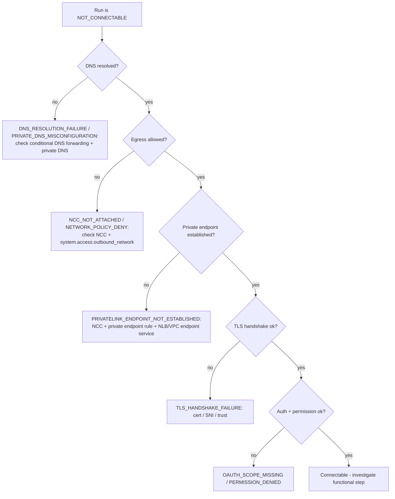

# PrivateLink / NCC troubleshooting

Network and private-connectivity failures are normalized into the
`RootCauseBucket` taxonomy so they can be grouped, charted, and remediated
consistently. The dashboard exposes PrivateLink-specific views (DNS / auth /
outbound-deny / handshake / read-write) backed by
`/api/v1/analytics/privatelink-failures`.

## Root-cause taxonomy -> remediation

| Bucket | Class | What it means | First things to check |
|---|---|---|---|
| `DNS_RESOLUTION_FAILURE` | connectivity | Hostname did not resolve | Conditional DNS forwarding configured? Private DNS zone reachable from serverless? |
| `PRIVATE_DNS_MISCONFIGURATION` | connectivity | Resolves to wrong/public IP | For front-end private connectivity, conditional DNS forwarding for `databricksapps.com` is **required** |
| `NCC_NOT_ATTACHED` | connectivity | No egress path for serverless | Attach an NCC to the workspace; NCCs are regional and can attach to multiple workspaces |
| `NETWORK_POLICY_DENY` | connectivity | Egress denied by policy | Inspect `system.access.outbound_network` for denied attempts; allowlist the domain/endpoint |
| `PRIVATELINK_ENDPOINT_NOT_ESTABLISHED` | connectivity | Private endpoint rule not ready/approved | NCC + private endpoint rule + NLB / VPC endpoint service. DNS chasing/redirect is **not supported** for private endpoint rules |
| `TLS_HANDSHAKE_FAILURE` | connectivity | TCP ok, TLS failed | Certificate/SNI/trust issues; confirm the endpoint terminates TLS as expected |
| `UPSTREAM_TIMEOUT` | connectivity | No response in time | Routing/firewall black-hole; verify the path end to end |
| `EXTERNAL_AGENT_UNAVAILABLE` | connectivity | Outside-in path needs a remote agent | Register/deploy a remote agent at the vantage point (BI / on-prem) |
| `OAUTH_SCOPE_MISSING` | auth | Token lacks a required scope | Check the app's `user_api_scopes` / SP entitlements |
| `PERMISSION_DENIED` | auth | Authenticated but not authorized | Grant least-privilege access to the target securable |
| `APP_RESOURCE_MISSING` | config | Required app resource not attached | Attach the SQL warehouse / Lakebase / connection resource |
| `SECRET_MISSING` | config | Expected secret not found | Create the secret scope/key and attach via `valueFrom` |
| `TARGET_NOT_FOUND` | config | Target object does not exist | Verify catalog/schema/connection/endpoint name |
| `SERVICE_UNSUPPORTED_IN_REGION` | capability | Feature/region not available | Pick a supported region or feature path |
| `FEATURE_NOT_ENABLED` | capability | Gated/enterprise feature off | Enable the feature (e.g. enterprise-only Agent) |
| `BUILD_EGRESS_BLOCKED` | platform | App build couldn't reach package repos | Allowlist package repos / required domains for restricted egress |
| `APP_DEPLOYMENT_FAILURE` | platform | App failed to deploy/start | Check `/logz`, port binding (0.0.0.0:$PORT), and the build step |
| `DATA_VALIDATION_FAILURE` | functional | Connected, but the operation/result was wrong | Inspect the functional step's payload excerpt and evidence |
| `CLEANUP_FAILURE` | functional | Temporary artifact cleanup failed | Manually verify/clean the temp object; check delete permissions |

## Decision flow for a "NOT_CONNECTABLE" run

## Lakehouse Federation note

For federation-style tests (e.g. Oracle), the network path is **directly**
between the Databricks compute / SQL warehouse and the external system. Unity
Catalog and the control plane are **not** on the data path - so a federation
connectivity failure is a compute-to-external path problem, not a UC problem.

## Apps networking note

With front-end private connectivity, conditional DNS forwarding for
`databricksapps.com` is required. For serverless workloads reaching internal AWS
resources, use NCC + private endpoint rules + an NLB or VPC endpoint service;
remember NCCs are regional and DNS chasing/redirect is not supported for private
endpoint rules. Denied outbound attempts are debuggable via
`system.access.outbound_network`.
